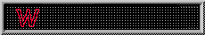
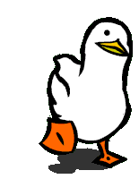

  

<h1 align="center">Hey, I'm Matheus </h1>

  Information Systems graduate from <b>IFES</b> 
  <b>Data Scientist</b> focused on <b>Computer Vision</b> 
  Dreaming big: I want to become a <b>Game Developer</b>

  

---

### What I do

I teach machines to see: **classification**, **segmentation**, **detection** and **OCR**.
I cover the whole MLOps loop, from preparing the data to testing and deploying the model.
Deep learning all the way: PyTorch/torchvision, Ultralytics YOLO, ResNet, VGG and friends.

### Languages & Tools

  

  

  

